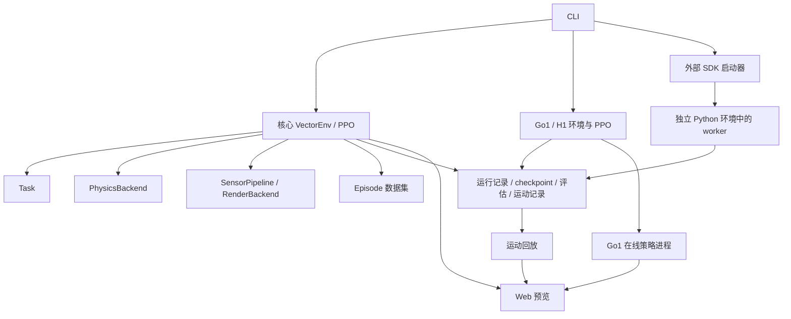

# 架构与模块边界

本文是模块边界和执行路径的统一说明。操作命令见 [训练与部署](training-deployment.md)，公共接口见 [接口说明](interfaces.md)。

## 三条执行路径

| 路径 | 入口与实现 | 复用范围与边界 |
| --- | --- | --- |
| 核心参考运行时 | `cli.py`、`env.VectorEnv`、`training.py` | `reach` / `hold`、CPU 点质量场景、公共任务/后端协议、Episode 数据集 |
| 原生机器人训练 | `recipes.py` → Go1 worker；`native_h1.py` → H1 环境与 PPO | 本仓库维护任务与算法；依赖 MuJoCo/mjbatch；尚未通过核心 `VectorEnv` 执行 |
| 外部 SDK 工作流 | Microduck、IsaacLab H1、Wuji、ACT、RLinf、Weave、GMR、SONIC 等独立入口 | 独立 Python 环境、固定来源与请求/结果文件；环境和训练器保留各 SDK 的接口 |

统一 CLI 负责分发，不能由命令同属 `embodiedforge` 推断它们具有相同的环境、checkpoint 或数据集格式。恢复和评估必须使用对应工作流的入口。

## 核心控制步

`VectorEnv` 装配任务、物理后端、渲染器和传感器，并拥有后端生命周期。任务定义初始化、观测、动作语义、奖励和终止；物理后端推进动力学；传感器负责采样频率、标定、帧龄和有效性。

一次 `step` 校验并裁剪动作、推进活动环境、取得状态快照、计算任务结果、按需采样相机，然后返回 reset 之前的观测。终止环境冻结，调用方显式按 ID reset。每个环境/episode 使用独立随机序列；返回观测拥有独立数组。后端或任务执行失败会关闭环境，调用方需要重新构造实例。

`backends.resolve` 在分配资源前校验场景、控制单位、局部 reset、活动掩码、设备、传输路径和图像通道。SDK 延迟加载，核心包只要求 NumPy。当前解析器只接受 CPU `host_snapshot`，并没有实现 CUDA 事件、设备零复制或通用机器人状态桥。

`SceneSpec` 当前描述平面受力球体，`StateSnapshot` 提供位置、速度、时间与版本。多个物理后端验证的是此参考场景的可替换性，不能据此推断任意机器人场景可以直接切换后端。

## 策略、训练与数据

核心 PPO 使用 proprio，区分 `terminated` 和 `truncated`，并支持保存后的训练状态恢复。Go1/H1 分别维护机器人策略与训练循环，部分数学和 checkpoint 校验工具共享。外部 SDK 的训练器在 SDK 环境中执行。

`policies.ActionExecutor` 消费 `[N,H,A]` 动作 chunk，向环境提供 `[N,A]`，并依据 episode/step 标识丢弃过期动作。模型内部历史或 KV cache 仍需调用方清理。

核心环境直接满足 `envs.base.BatchEnvironment`；原生 Go1/H1 可通过借用式适配器使用同一个 CPU 评估器和 transition 消费接口。环境规格版本 1 显式区分完成行冻结和下一步前必须 reset，两类消费者共用 `envs.specs` 的启动校验；未声明版本的旧规格继续支持。原生训练循环仍独立，适配器不保证逐行冻结，详见 [环境适配与评估](environment-adapters.md)。共用 GAE、张量有限性检查、Adam 校验与探索参数工具归属 `learning` 包，机器人策略模块不导入仿真模块。

`data.EpisodeRecorder` 通过公共环境协议记录完整 transition，支持有界内存、可选后台写入与显式背压。核心环境提供默认元数据；Go1/H1 等原生适配器需要显式 `RecordingMetadata` 描述配置和来源。读者只接受已完成的 episode；窗口不跨 episode。此数据出口尚未自动接入所有 SDK 工作流。ACT 通过单独的数据适配接入 LeRobot，导出目前限定核心环境；公共 chunk 与数据窗口接口本身不代表已实现通用 VLA 训练器。

记录器在修改缓存前校验批次和 episode 的 schema、布局与数值类型。可选完整性路径在发布 NPZ 前校验 ZIP CRC，并在读回时使用完成标记中的 SHA256 核验压缩文件；配置与 I/O 成本见 [环境适配与评估](environment-adapters.md#可选归档完整性核验)。

`data.py` 负责记录器状态、缓冲与写入线程、完成标记发布，以及数据目录的分片/投影/窗口迭代。私有 `_episode_archive.py` 解释单个 NPZ 的布局并校验 manifest、数值与连续性；它不反向依赖记录器或读选项对象。公开的 `EpisodeRecorder`、`RecordingMetadata`、`EpisodeReadOptions`、`read_episodes` 和 `action_windows` 仍从 `embodiedforge.data` 导入。compact 归档的相邻状态视图仅供内部窗口迭代使用，公开读取继续返回独立数组。

运行记录、来源校验和 checkpoint 校验承担不同责任：运行记录描述状态与配置；来源校验追踪实现和资产；checkpoint 校验决定是否可以加载或恢复。运行状态为 `complete` 不代表策略达到验收阈值，也不能单独证明 checkpoint 兼容。

实现快照、SuperMimic 预检和 ACT 指纹共用 `runtime.hashing.snapshot_file_hashes`，从同一个普通文件描述符进行有界读取和身份复核。实现快照把源文件复制与首次哈希合并，之后独立校验目标内容，并在全部复制完成后重新校验源清单；每个文件的逻辑内容读取由四遍减为三遍，这不等同于实测耗时降低。写入目标必须是新文件，失败时调用方负责处理未发布的部分输出。Go1 的已记录实现也使用同一复制工具，将源读取与首次哈希合并，随后独立校验目标；每文件的内容处理由三遍减为两遍，私有目标已存在时拒绝覆盖。通用 `file_sha256` / `stream_sha256` 继续保留读取至 EOF 的原有语义，运动库导入和加载复用同一个流哈希实现。身份检查不提供文件锁，也不保证祖先目录在并发替换时保持不变。

核心 PPO、Go1、原生 H1、Microduck、运动文件和 JSON 发布共用 `runtime.artifacts.discard_partial` 清理失败操作拥有的临时文件；清理失败或再次中断单独记录，保留原始保存异常或中断。Go1 的恢复记录直接使用一次原子 JSON 发布，再更新便捷模型副本；恢复仍只认已提交记录引用的快照。

Microduck 与 Weave 的 SDK runner 通过 `learning.checkpoints.atomic_save` 借用保存回调，先写唯一的同目录临时文件，成功后替换目标文件；Weave 无需导入 Microduck 任务包。该工具只负责一个 checkpoint 文件的发布，各工作流继续提交各自的运行记录与恢复指针。Microduck 原模块保留兼容导出。

公共工具归属 `runtime` 包，新运行增加版本化 `run_contract`，可通过 `embodiedforge runs inspect --run ...` 查询；旧产物保持原格式。字段与兼容范围见 [公共运行记录](run-records.md)。

包入口按需加载 `Config`、`VectorEnv` 等公共导出；导入 `runtime` 工具或执行 `runs inspect` 只依赖标准库，不加载 NumPy 或核心环境。CLI 先分发元数据与 SDK 工作流，再为核心命令装配后端、环境、采集和策略模块。请求核心类型时继续返回原定义模块中的对象，序列化与原有导入形式保持兼容。

核心 CLI 的 `plan`、`doctor` 和参数解析只加载所需的配置与注册信息，仿真、采集和 rollout 在执行相应命令时装配。核心策略与 checkpoint 加载器仍归属 `training.py`，环境构造延迟到 `train_ppo`；仅加载策略或解析续训输入不会导入环境、物理后端或传感器实现，但仍需要 NumPy 与 PyTorch。

主机训练与 SDK 启动器共用 `runtime.process` 的进程组、取消转发和有界日志读取，以及 `runtime.records.run_lifecycle` 的终态发布。执行异常在收尾失败时保持为主错误，清理范围限定为启动器拥有的作业组。模型与产物的验证、发布和回滚继续由所属工作流解释；详细状态约定见 [公共运行记录](run-records.md)。

`workflows` 包保存配方目录、Go1 设置继承、产物校验、结果验收和进度读取。`recipes.py` 负责 CLI 与执行编排；在线查看器直接使用产物校验模块，不反向导入命令入口。`recipes` 原有公共函数保留兼容导出。

RLinf 的固定版本与 SAC checkpoint 布局校验分别由 `workflows.rlinf_catalog` 和 `workflows.rlinf_artifacts` 维护。主机启动器、SDK worker、导出器和 ONNX 评估器直接依赖这些轻量模块；SDK 侧不再通过 CLI 入口加载格式工具。

SuperMimic 的固定来源与依赖版本校验归属 `workflows.supermimic_source`，预检入口、训练启动器和 reference worker 直接复用它，SDK 侧不导入预检 CLI。新工具模块列入两条训练路径的来源校验。Microduck 的进程身份、存活检查和 checkpoint 发现归属 `_microduck_run`，主机启动器不再为这些文件/进程操作导入 SDK worker；worker 保留原有函数导出，新的依赖随整个包进入已有实现快照。

## 预览与训练图像

`viewers.WebViewer` 用 HTTP 线程接收命令并发送已发布画面，仿真、相机和渲染器生命周期在会话主线程处理。浏览器共享同一个会话，不是独立训练作业。

隔离的图形进程使用私有 `viewers._frame_channel.FrameChannel` socket 通道，由同一 Python 环境编码与解码快照和 RGB 数组。一次渲染请求的发送与完整响应共用一个绝对截止时间；部分收发不会重新获得等待预算，传输失败后废弃该通道并清理所属子进程。单条编码消息限制为 64 MiB，约束发送缓冲和接收帧分配；同步编码/解码在前后核对期限，无法被截止时间抢占，也不提供整个对象图及其临时分配的内存硬上限。具体计时与兼容范围见 [可视化后端](viewers.md#框架与扩展点)。

发送前，已知的点任务和机器人快照仅复制选中环境的显示数据，子进程按局部行零渲染，公共 `env_id` 与主线程观测保持不变。点任务保留状态与 agent/target 位置，GL/RTX 点渲染还保留独立的观测时间；机器人保留 qpos 与场景时间。未知快照、子类或所需字段中的自定义数组回退到原快照、完整观测与原 ID。默认 Web 演示使用空图像通道；投影主要减少带训练图像观测或多环境调用中的无关传输。Go1 跨 Python 环境的在线策略仍使用原 JSON 通道。

Go1 与 Wuji 的只读训练预览使用 `viewers.training.MujocoTrainingPreview`，共享 HTTP/JPEG 发布、节流、MuJoCo 状态还原和资源收尾。它接收时间、qpos、qvel 与可选 mocap 姿态快照；机器人适配器分别提供模型装配、快照和相机目标。训练钩子仍由各工作流拥有，预览跟随实际训练步，不具备 WebViewer 的交互控制协议。

Go1 在线模式在兼容 Python 环境中运行策略，通过有界消息通道传递状态；运动回放读取记录，不重新执行策略或物理。

Web 的 `FrameRenderer` 与核心训练的 `RenderBackend` 是两套接口。Web 支持 MuJoCo、OpenGL、RTX 等画面不等于核心训练观测支持这些后端。视觉训练接入需另外验证标定、采样时间、状态版本与数据布局。

## 演进顺序

先保持现有训练入口和产物兼容，提取公共进程、产物与来源工具，再建立可扩展的运行记录协议。随后通过最小环境适配接口让 Go1/H1 复用采集与评估工具，用真实机器人需求检验协议。GPU 状态与通用资产协议应在具体后端需求明确后扩展。

使用指南以稳定主题名称维护；实验结论、原始测量和证据包单独归档，日期属于实验元数据。历史报告中的版本、测试数量和性能数字仅对应其记录条件。

SuperMimic 的 `catalog` / `preflight` 只做来源和接口预检；仓库根目录的 `./supermimic` 使用独立 SDK 执行训练、播放和评测。后空翻 reference 实现保留完整世界模型、BPTT 策略与价值网络更新，以 mjlab 承载物理仿真，并分别保存实际状态、接触力和验收记录。它不采用核心 PPO 或核心 checkpoint 格式，见 [运行说明](supermimic.md)。

## 扩展约束

按具体工作流的需求扩展现有边界。新增后端先声明场景、动作、设备、reset 和传输能力，再验证目标任务；不能由统一 CLI 推断后端可互换。GPU 状态视图、通用资产注册与多作业调度尚未实现，应在实际需求出现时设计，当前不预建对应的平行接口和服务层。
