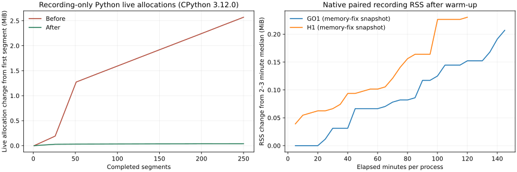

# 架构边界与持续运行验证

本轮接续[上一轮架构重构](architecture-refactor.md)，工作区以其全部未提交改动为基线。开始时间为 2026-10-20 10:05:18 UTC，本轮已持续至少四个实际小时并完成验证；最终检查结果见[结构化记录](architecture-continuation.json)。

## 已确认的问题与改动

| 优先级 | 问题 | 改动与验证范围 |
| --- | --- | --- |
| P0 | episode 字段删除或 dtype 改变可能延迟到写盘时失败，或被自动转换 | 批次写入前校验 episode schema、布局及真实数值；错误可修正后重试 |
| P0 | 数据读取可把其他 workflow 当作空数据集，或忽略清单与必要数组维度的矛盾 | 完整清单按数据集身份与环境规格校验；保留无身份的旧数据集和 schema-only 独立档案读取 |
| P0 | CPython 3.12 唯一 episode 文件名的路径解析造成长期内存增长 | 高频 JSON/episode 文件操作使用字符串路径；扫描保留排序和隐藏档案语义 |
| P0 | 首次发布 `running` 后的异常不在生命周期收尾范围内 | 初次发布纳入异常保护；失败和真实 SIGTERM 分别验证启动阶段与执行体阶段 |
| P0 | 延长录制捕获一份 NPZ 的 CRC 损坏，原异常缺少归档路径 | 增加可选写后 CRC / 读前 SHA256 核验及路径上下文；保留原坏文件，位翻转来源仍未确定 |
| P1 | RLinf worker/导出器/ONNX 格式工具反向导入 CLI | 固定版本与 SDK 无关的校验归入 `workflows.rlinf_catalog` / `rlinf_artifacts`；保留旧入口 |
| P1 | 源码包漏掉归档 JSON、SVG、脚本和证据包 | 完整包含版本化文档，CI 解包再检查文档与模块边界；wheel 继续只发布运行时 |
| P2 | 公共评估器全量 reset 仍复制终止观测 | 与核心 rollout 共用 owned reset 数组的安全合并路径，保留 NumPy dtype/子类/广播语义 |
| P2 | 新增 schema 检查逐行重复构造字段集合、比较相同批次布局 | 每批构造一次字段集合并检查前后布局；逐行保留 episode 连续性检查 |

源码快照清单、原始失败和修复后日志位于本地 `runs/architecture-continuation/`。原有训练目录不作重写。源码发行包因为包含历史证据压缩包而变大；这些归档不进入 wheel。

## 兼容性边界

本轮保持核心与原生训练算法、控制周期、奖励和 checkpoint 布局。原有 `rlinf` 模块仍提供校验入口；公开的 `REPLAY_WINDOW` 覆盖行为通过兼容包装保留。实现快照使用 POSIX 相对路径键，并拒绝 Windows drive 路径，避免跨平台解释不一致。

数据读取首先保留原来的精确 episode ID 校验，包括大整数和不同字节序。只有带完整运行清单的数据集才要求其必要数组匹配清单维度；原来只带 schema 号的独立档案仍可通过 `read_episodes` 读取，action window 需要实际记录的语言指令。

## 持续验证方法

`benchmarks/native_recording_soak.py` 构造配对 Go1 或 H1 环境，使用相同种子和零动作，逐段比较同步完整格式和异步紧凑格式经公共读取器还原的数据与评估指标。每段验证后只删除该段自己的临时数据，避免长时间压测无限占用磁盘。保留每段散列、资源样本和最终摘要。

压测每段关闭记录器，检查其保留载荷、pending rows、future 和 executor 均已释放，采样进程 RSS、线程和文件句柄。RSS 包含原生求解器和分配器，不能直接等同于记录器的字节预算；可用 `--trace-allocations` 进一步区分 Python 存活对象。

已有运行的参考源码与修改后源码还会比较相同序号段的散列；执行段数不同只比较共同前缀。零动作检查接口与数据一致性，不代表学到了行走能力。

`benchmarks/rollout.py --runner single` 测量公共评估路径；默认 `chunked` 保持原有测量。计时、分配追踪和含散列的完整数据检查分开执行；分配峰值不是 RSS，局部收益不表示整个训练吞吐同等提高。

## 已复现的路径内存问题

本机 Python 3.12.0 的录制对照在 250 轮后，由 `pathlib._parse_path` 保留约 2.65 MB、23967 个字符串；单独原生仿真、单独重复读取和线程池压缩对照均较稳定。这与 CPython 已报告的[唯一 Path 路径组件长期保留问题](https://github.com/python/cpython/issues/121780)一致。改用 filesystem 字符串后，相同录制对照的增量降至数十 KB，保留原子 rename、独占临时文件与失败清理。

文件名与数据格式未变；读取仍按原顺序处理完整档案，包括隐藏 `.npz`。调用方传入的 `Path` 仍被支持，内部高频 episode 名称避免再构造 Path。核心 RGB/depth 控制压测可使用 `--task core --image-size 64`，其环境由压测明确拥有并关闭；原生任务继续保持借用式适配器边界。

## 压测捕获的归档损坏

H1 长测的一份异步 NPZ 在读回时触发 `reward.npy` 的 CRC 错误。与同步对应文件比较，压缩流相差两个位，解压后的差异位于 NPY 头部，奖励数值字节相同。原文件、SHA256、失败状态和逐字节对照保留在本地证据中；位翻转来源尚未确定。诊断只在内存副本中还原这两位，原文件未被修复或覆盖。固定输入单线程及双线程各重新编码 5000 次均通过 CRC，不能据此排除其他运行或存储因素。

因此新增了可选写后 CRC / 读前 SHA256 核验及明确文件路径的错误上下文，保留默认读写成本。严格模式另用新实现快照执行 Go1/H1 持续对照；此前与优化后源码版本的边界在结构化记录中分别列出。

<!-- observed-results -->

## 实测结果

本轮工作实际经过 4.003 小时。完整回归：Python 3.10 为 3131 passed / 80 skipped，Python 3.12 为 3219 passed / 59 skipped / 25 subtests passed；各有 11 项警告。真实 RLinf SDK 检查 39 passed。源码包解包后 71 项文档、架构及导入边界检查通过。

| 连续录制对照 | 实测分钟 | 每种存储的 episode / transition | 数据一致 | 实际子进程退出码 |
| --- | ---: | ---: | --- | ---: |
| GO1 内存修复快照 | 145.00 | 1,033,696 / 33,078,272 | 是 | 0 |
| H1 内存修复快照 | 120.00 | 635,040 / 20,321,280 | 是 | 0 |
| GO1 CRC/SHA 快照 | 60.00 | 448,800 / 14,361,600 | 是 | 0 |
| H1 CRC/SHA 快照 | 60.00 | 361,920 / 11,581,440 | 是 | 0 |
| 核心 RGB/depth（默认模式） | 60.00 | 168,352 / 2,674,072 | 是 | 0 |
| 最终 wheel RGB/depth（严格模式） | 60.00 | 265,828 / 4,224,058 | 是 | 0 |

每组内部比较同步 transitions 与异步 compact；表中步数均为**每种存储模式**，不作翻倍。原生环境采用零动作 CPU 仿真，核心环境包含 64×64 RGB/depth。它们验证采集、评估及资源生命周期，不衡量策略学习质量。不同运行的种子、主机负载及核验开销不同；段数和步数描述验证覆盖量，不构成吞吐对照。

内存修复快照与优化前的一小时参考分别比较共同前缀：Go1 9090 段，H1 7259 段，散列一致；超出此前参考长度的部分不计入这项对照。CRC/SHA 快照随后加入完整性检查，其全部 Go1 14025 段、H1 11310 段还与内存修复快照的对应前缀比较，载荷散列及 episode/transition 数量均一致；最终发行实现又补上整数文件描述符拒绝规则，已通过完整回归和最终 wheel 图像严格长测。

路径修复的 250 段对照中，Python 存活分配增量从 2,695,250 字节降至 41,102 字节。两组原生长测的 RSS 曲线与这一 Python 对照分别展示；RSS 含原生求解器与分配器。



复现图表：

```bash
python docs/experiments/assets/architecture-continuation-resources.py \
  --report docs/experiments/architecture-continuation.json \
  --output docs/experiments/assets/architecture-continuation-resources.svg
```

## 失败记录与交付边界

单独的 H1 延长测试在第 3555 段读回时遭遇上述 CRC 损坏，实际退出码为 1。表中的 H1 两小时成功结果来自独立监督运行，不替代或掩盖失败记录。首次严格模式启动曾误指向旧快照并因不支持参数而失败，纠正快照后重新运行。

更早的两组三小时外层执行会话以 143 结束，未生成完整摘要，原因尚未确定；另有一小时外层会话虽写完摘要也返回 143。因此本文对成功长测使用独立父进程保存的真实子进程退出记录，旧失败目录和状态原样保留。

964 份原有运行清单散列均未改变；两份旧数据集共 205 episodes / 16744 transitions 的读取散列保持一致。wheel 安装后核对了 132 个 Python 模块及全部 180 个运行时文件，均与最终源码相同；还通过无 SDK 核心采集与安装包中的原生 Go1/H1 严格读写。

源码包包含历史文档证据，约 65.5 MB；wheel 约 8.24 MB，不含实验归档。本轮不包含 GPU tensor 传输或通用机器人资产注册层。改动保留在工作区，未提交或推送。
